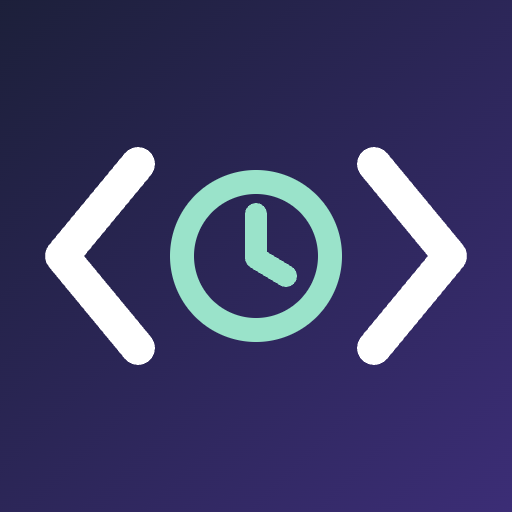
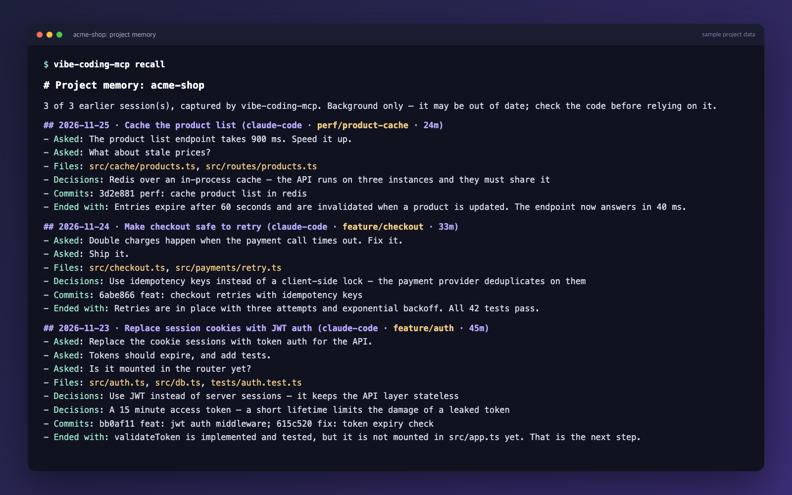

<p align="center"></p>

# vibe-coding-mcp

> Your AI coding sessions, documented automatically. Captures every Claude Code session from its transcript — prompts, files changed, commands, design decisions — then turns them into standups, weekly reports, ADRs and PR descriptions, and publishes them to Notion / Obsidian / GitHub Wiki / Confluence / Slack / Discord.

[](https://github.com/MUSE-CODE-SPACE/vibe-coding-mcp/actions/workflows/ci.yml)
[](https://www.npmjs.com/package/vibe-coding-mcp)
[](https://opensource.org/licenses/MIT)


[English](#english) · [한국어](#한국어)

---

<a name="english"></a>
## Why vibe-coding?

You spent four hours pair-programming with Claude. You made three architectural decisions, wrote eight files, and reverted twice. Tomorrow you will not remember why you picked the second option over the first. Most people solve this with manual journaling that lasts two weeks, or by trawling `git log` after the fact — and `git log` knows *what* changed, not *why*.

vibe-coding-mcp fixes that at the source. Claude Code already writes a full transcript of every session to `~/.claude/projects/`. A tiny hook (`vibe-coding-mcp hook`) parses that transcript after every turn and stores a structured session locally: what you asked, which files were written or edited (with the code), which commands ran, how long it took, which branch, and the design decisions it can detect in the conversation. Codex CLI sessions (`~/.codex/sessions/`) are captured the same way with `vibe-coding-mcp sync`. From there, 18 MCP tools turn those sessions into **project memory** ("what did we do here last time, and why?"), a **standup**, a **weekly report**, a **daily log**, a **DESIGN / ADR / README / API doc**, or a **PR description**, and publish them anywhere.

No API key needed for capture. Everything stays on your disk until you publish.

## 30-second install

```bash
# 1. Register the MCP server with Claude Code (tools, resources, slash-command prompts)
claude mcp add -s user vibe-coding-mcp -- npx -y vibe-coding-mcp

# 2. Install the hooks into ~/.claude/settings.json (backup written first):
#    Stop + SessionEnd capture every session, SessionStart briefs each new session
#    on earlier work in the same project (skip that part with --no-recall)
npx -y vibe-coding-mcp init

# 3. Restart Claude Code. Then import the sessions you already have
#    (every project, Claude Code + Codex CLI, last 30 days) and check health
npx -y vibe-coding-mcp sync
npx -y vibe-coding-mcp doctor
```

Then, inside Claude Code:

```
/catch-up                    → where this project stands: earlier sessions, decisions, loose ends, next step
/standup                     → Yesterday / Today / Blockers from captured sessions
/weekly-report               → Shipped / Decisions / In progress / Next, per project
/daily-vibe-log              → today's sessions as one log, offer to publish
@vibe-coding://search/redis  → every session that touched redis (titles, prompts, or file paths)
```

Or just ask: *"why did we choose JWT over sessions last week?"*, *"document yesterday's session as a DESIGN doc and put it in my Obsidian vault"*, *"write the PR description for this refactor"*.

> **Upgrading from v2.14?** The old README's hook recipe used `claude mcp call`, which is not a real Claude Code command, so nothing was ever captured. Run `npx vibe-coding-mcp init` and remove the old entries. See [`docs/AUTO_CAPTURE.md`](./docs/AUTO_CAPTURE.md).



<sub>Sample project data. More: [weekly digest](./docs/assets/screenshot-digest.png) · [backfill and search](./docs/assets/screenshot-sync-search.png). The skill is also listed on [Agensi](https://www.agensi.io/skills/vibe-coding-memory-for-your-ai-coding-sessions).</sub>

## What's new in v2.16.0

- **Project memory.** `muse_recall` (and `vibe-coding-mcp recall [query]`) answers "what did we do in this project before, and why?" from captured sessions: asks, files, decisions with rationale, commits, how the session ended. With a query it ranks sessions across titles, decisions, file paths and commit subjects.
- **New sessions start informed.** `init` now also installs a `SessionStart` hook that hands Claude Code a short brief (3 sessions, ≤ 2000 chars by default) of earlier work in the same project. Opt out with `init --no-recall` or `VIBE_CODING_RECALL=off`.
- **Codex CLI capture.** Rollouts under `~/.codex/sessions/` are parsed into the same session shape (prompts, `exec_command` commands, `apply_patch` file changes, tokens, model).
- **`sync`.** One command captures every new or changed transcript on the machine, across all projects and both agents. Re-runs skip what is already up to date. Also available as `muse_capture_transcript { action: "sync" }`.
- **Token usage, models and commits per session.** API-reported tokens (deduplicated per response), responses per model, and the git commits made in the project while the session ran. `muse_digest` totals them.
- **Cleaner captures.** Harness-authored records (skill preambles, hook notices, compaction summaries, background-task results) no longer count as prompts; auto-captured decisions must carry a stated reason; digest and recall dates use your local time zone.
- **HTTP server hardened.** Binds `127.0.0.1` by default, optional `MCP_AUTH_TOKEN` bearer auth, CORS/Origin allow-list instead of `*`, idle-session reaping, graceful shutdown.
- **MCP surface.** Every tool carries a title and behaviour annotations (`readOnlyHint` etc.), and the server sends usage instructions on `initialize`.

## What's new in v2.15.0

- **Auto-capture that works.** `vibe-coding-mcp hook` reads Claude Code's hook JSON on stdin, parses the session transcript, and upserts one session per Claude session (idempotent, exit 0 always, nothing on stdout).
- **`init` / `doctor` / `capture` CLI.** Install the hooks with a merge + backup, diagnose, backfill history.
- **`muse_digest`.** Standup / weekly / monthly report over captured sessions, grouped by day · project · tag, English or Korean.
- **`muse_capture_transcript`.** Capture on demand from inside the chat ("save this session").
- **Resources** `vibe-coding://sessions/today`, `vibe-coding://search/{query}` and **prompts** `/standup`, `/weekly-report`.
- **Agent Skill.** `skills/vibe-coding/` tells any skill-aware agent (Claude Code, Cursor, Codex, …) when and how to use the server. `npm run skill:pack` builds the zip.

## Real use cases

### 1. "Write my standup"
`/standup` calls `muse_digest` for yesterday and today plus `muse_git status`, and returns three bullet groups. Every bullet traces to a captured session title, file path, or decision — nothing invented.

### 2. "What did I ship this week?" (for your 1:1, Slack, or Notion)
`/weekly-report` calls `muse_digest { period: "week", groupBy: "project" }`: totals (sessions, hours, files, decisions), highlights (decisions with rationale), per-project sessions with the files they touched, and most-touched files. Optionally `muse_publish_document` to Notion / Slack.

### 3. "Why did we pick option B?"
`@vibe-coding://search/<keyword>` matches titles, summaries, tags **and touched file paths**. Open the session; `designDecisions` holds problem → choice → rationale, and `summary` holds the actual prompts you typed. This is the context a diff cannot give you.

### 4. "PR description for a refactor that touched 11 files"
`/refactor-context` chains session → `muse_summarize_design_decisions` → `muse_analyze_code` (AST + Mermaid) → `muse_git diff` into Why / What changed / Trade-offs / How to review.

### 5. "Fill my Obsidian vault with ADRs"
`muse_summarize_design_decisions` over a session, `muse_generate_dev_document { documentType: "DESIGN" }`, `muse_publish_document { platform: "obsidian" }` — frontmatter, tags and a session back-reference included.

## Tools / Resources / Prompts

| Name | Type | What it does |
|------|------|--------------|
| `muse_recall` | tool | **(new)** Earlier sessions of a project, newest first or ranked by a query: asks, files, decisions, commits |
| `muse_capture_transcript` | tool | Claude Code / Codex transcript → stored session (`capture` / `preview` / `list` / `sync` for a machine-wide backfill) |
| `muse_digest` | tool | Standup / weekly / monthly report over captured sessions, grouped by day / project / tag, with token and commit totals |
| `muse_session_history` | tool | `save / get / update / delete / list / search / stats` over `~/.vibe-coding-mcp/sessions/` |
| `muse_session_stats` | tool | Productivity dashboard: sessions/day, decisions/session, language breakdown |
| `muse_summarize_design_decisions` | tool | Extract decisions (problem → options → choice → trade-off), EN/KO, optional Claude API |
| `muse_analyze_code` | tool | AST analysis (TypeScript / Python / Go) + Mermaid diagrams |
| `muse_generate_dev_document` | tool | README / DESIGN / TUTORIAL / CHANGELOG / API / ARCHITECTURE generator |
| `muse_create_session_log` | tool | Daily or per-session log composition |
| `muse_export_session` | tool | Export sessions to Markdown / JSON / HTML |
| `muse_normalize_for_platform` | tool | Markdown quirks for Notion / GitHub Wiki / Obsidian |
| `muse_publish_document` | tool | Publish to Notion / GitHub Wiki / Obsidian / Confluence / Slack / Discord |
| `muse_collect_code_context` | tool | Pull code blocks + summary out of raw text |
| `muse_git` | tool | `status / log / diff / branch / snapshot` + decision extraction from commits |
| `muse_auto_tag` | tool | Tag suggestions (Claude API, optional) |
| `muse_template` | tool | Custom doc templates |
| `muse_project_profile` | tool | Per-project defaults (platform, tags, language) |
| `muse_batch` | tool | Several tool calls in one round-trip |
| `vibe-coding://sessions/list` | resource | All captured sessions |
| `vibe-coding://sessions/today` | resource | Sessions started today, with files touched |
| `vibe-coding://sessions/{id}` | resource | One session in full |
| `vibe-coding://search/{query}` | resource | Keyword search incl. file paths |
| `vibe-coding://config` | resource | Which publish platforms are configured |
| `/daily-vibe-log` | prompt | Today's sessions → one daily log |
| `/catch-up` | prompt | **(new)** Where the project stands: recall + git status → decisions, loose ends, next step |
| `/standup` | prompt | Yesterday / Today / Blockers |
| `/weekly-report` | prompt | Shipped / Decisions / In progress / Next |
| `/document-session` | prompt | Session → dev document → publish |
| `/refactor-context` | prompt | Session → PR description |

## The skill

`skills/vibe-coding/` is an [Agent Skill](https://agentskills.io) (`SKILL.md` + `references/` + `scripts/setup.sh` + `assets/`). It teaches the agent: check that capture is running before reporting, which tool chain matches which request, output shapes for standup / weekly / PR, and the rule that every reported line must trace to a captured session. Install it alongside the MCP server:

```bash
# Claude Code: drop it into your skills directory
cp -r skills/vibe-coding ~/.claude/skills/

# or build a zip for a marketplace (Agensi, etc.)
npm run skill:pack      # → dist-skill/vibe-coding-skill-<version>.zip
```

## How it works

```
 Claude Code ──Stop / SessionEnd hook──▶ vibe-coding-mcp hook ──▶ ~/.vibe-coding-mcp/sessions/*.json
      │   (stdin: session_id,             │ parse ~/.claude/projects/<slug>/<id>.jsonl
      │    transcript_path, cwd)          │ prompts · files+code · commands · timing · tokens · commits · decisions
      │                                   │ upsert by agent session id
      │ ◀──SessionStart hook── project-memory brief (earlier sessions in this cwd)
      │
 Codex CLI ──(no hook)── vibe-coding-mcp sync ──▶ same store (~/.codex/sessions/**/rollout-*.jsonl)
      ▼
 Claude (or any MCP client) ──▶ src/cli.ts ──▶ src/stdio.ts ─┐
                              src/index.ts (HTTP, POST /mcp) ─┴─▶ src/core/mcpServerFactory.ts
                                                                    ├─ toolRegistry.ts   (18 muse_* tools)
                                                                    ├─ resources.ts      (5 resources)
                                                                    └─ prompts.ts        (6 prompts)
                                                                          │
                                                                          ▼
                                            src/tools/*.ts · src/core/{captureEngine,transcriptParser,codexParser,recall}.ts
                                            src/core/sessionStorage.ts · src/platforms/*.ts
```

Design choices that matter:

1. **Capture reads the transcript, not the editor.** Claude Code already logs everything; we parse it after the fact. The capture hooks do no network calls, write nothing to stdout, and exit 0 even on failure, so they can never slow down or break a session. Only the `SessionStart` hook prints anything: the project-memory brief.
2. **One session per agent session.** The `Stop` hook fires after every turn; captures are keyed on the agent's session id and update in place (an index file keeps that lookup cheap, writes are atomic). User-added tags survive updates.
3. **Local-first.** `~/.vibe-coding-mcp/sessions/<id>.json`. No DB, no telemetry. `grep`, back up, or sync it however you like.
4. **One registry, two transports.** HTTP and stdio expose the same 18 tools / 5 resources / 6 prompts via `createMcpServer()`.

## CLI reference

```
vibe-coding-mcp                 start the MCP server (stdio)
vibe-coding-mcp init            install hooks into ~/.claude/settings.json:
                                Stop + SessionEnd (capture), SessionStart (project-memory brief)
    --no-recall                 capture only; no SessionStart brief
    --project | --local         target .claude/settings.json | .claude/settings.local.json
    --dry-run | --print         show merged file | print only the hooks block
    --remove                    uninstall
    --command "<cmd>"           custom hook command
vibe-coding-mcp capture         capture the newest transcript for the cwd
    --all                       every transcript for the cwd (backfill)
    --transcript <path> --cwd <dir> --dry-run --json
vibe-coding-mcp sync            capture every new/changed transcript on this machine (all projects)
    --agent claude|codex|all    default all
    --days <n>                  look-back window, default 30
    --limit <n> --dry-run --json
vibe-coding-mcp recall [query]  earlier sessions of this project (newest first, or ranked by query)
    --all                       search every project
    --cwd <dir> --project <name> --limit <n> --days <n> --lang ko --json
vibe-coding-mcp doctor          hooks · transcripts (Claude Code + Codex) · store · last hook run · platforms
vibe-coding-mcp hook            (used by the hooks) stdin JSON → capture, or the SessionStart brief
```

## Configuration

| Env var | Required for | Purpose |
|---------|--------------|---------|
| *(none)* | capture, digest, search, docs | Works with zero configuration |
| `ANTHROPIC_API_KEY` | `useAI` options, `muse_auto_tag` | Claude-API-powered analysis |
| `NOTION_API_KEY` + `NOTION_DATABASE_ID` | Notion publishing | |
| `GITHUB_TOKEN` + `GITHUB_REPO` | GitHub Wiki publishing | |
| `OBSIDIAN_VAULT_PATH` | Obsidian default vault | or pass `options.vaultPath` |
| `CONFLUENCE_BASE_URL` + `CONFLUENCE_USERNAME` + `CONFLUENCE_API_TOKEN` + `CONFLUENCE_SPACE_KEY` | Confluence | |
| `SLACK_WEBHOOK_URL` / `DISCORD_WEBHOOK_URL` | Slack / Discord | |
| `VIBE_CODING_STORAGE_DIR` | — | Move the session store |
| `CLAUDE_CONFIG_DIR` / `CODEX_HOME` | — | If Claude Code's / Codex's config is not in `~/.claude` / `~/.codex` |
| `VIBE_CODING_RECALL` | — | `off` disables the SessionStart brief without uninstalling the hook |
| `VIBE_CODING_RECALL_SESSIONS` / `_CHARS` / `_LANG` | — | Brief size (default `3` sessions, `2000` chars) and heading language (`en` / `ko`) |
| `PORT` / `HOST` | HTTP mode only | default `3000` / `127.0.0.1` (set `HOST=0.0.0.0` to expose it) |
| `MCP_AUTH_TOKEN` | HTTP mode only | When set, `/mcp` requires `Authorization: Bearer <token>`. Set it whenever `HOST` is not loopback |
| `MCP_ALLOWED_ORIGINS` | HTTP mode only | Comma-separated browser origins allowed to call `/mcp` (default: none) |
| `MCP_SESSION_TTL_MIN` | HTTP mode only | Idle minutes before an MCP session is closed (default `60`) |

Tools that need an unconfigured integration return a structured `INTEGRATION_NOT_CONFIGURED` error instead of crashing.

## Known limitations

- **Claude Code and Codex CLI.** Capture parses those two transcript formats; Cursor is on the roadmap. Only Claude Code has hooks, so Codex sessions are picked up by `sync` (run it by hand or on a schedule). Codex's rollout format changes between releases; the parser is best-effort and skips what it does not recognise. The MCP tools themselves work from any MCP client.
- **Commit linkage is by time window.** A session is linked to the commits made in its project directory between its first and last record, whoever made them.
- **Token counts are what the transcript reports** for the main conversation; sub-agent usage is not included, and no cost is computed.
- **Decision extraction is heuristic** unless `useAI: true` with an API key: it looks for "decided / chose / instead of / because" patterns in EN and KO. Auto-capture keeps only decisions with a stated reason, so expect few, and expect some noise.
- **AST analysis covers TS / Python / Go.**
- **Publishing is one-way.** Edits made in Notion / Wiki are not pulled back.
- **Single-user store.** Team search across everyone's sessions needs a shared store (roadmap).

## When NOT to use this

- Automatic **commit messages** → use aicommits or similar; this generates documents.
- **Team-wide search** across everyone's sessions → build a Notion DB on top, or wait for the shared store.
- **Hand-written rich notes** → use Obsidian / Notion directly; this is capture-then-publish.

## Roadmap

- Cursor transcript capture.
- Shared session store (S3 / Git / WebDAV) and team mode.
- `prepare-commit-msg` suggestions from the current session's decisions.
- Rust / Swift / Kotlin AST + diagrams.

## Contributing

```bash
git clone https://github.com/MUSE-CODE-SPACE/vibe-coding-mcp
cd vibe-coding-mcp
npm install
npm run typecheck && npm test && npm run build
node dist/cli.js capture --dry-run     # try the capture engine on your own transcript
```

Adding a tool is one file in `src/tools/<name>.ts`, a Zod schema in `src/core/schemas.ts`, and one entry in `src/core/toolRegistry.ts`. CI runs typecheck + build + tests on Node 22 and 24.

## Security

Paths are validated, filenames sanitized, webhook URLs must be HTTPS and allowlisted, outbound HTTP has timeouts and backoff — see [`src/core/security.ts`](./src/core/security.ts) and [`SECURITY.md`](./SECURITY.md). The capture hook stores only your prompts, the assistant's prose, the code it wrote, and the commands it ran; tool outputs, sub-agent side-chains and system reminders are dropped.

**Report vulnerabilities privately** via a GitHub Security Advisory: <https://github.com/MUSE-CODE-SPACE/vibe-coding-mcp/security/advisories/new>.

## License

MIT — see [`LICENSE`](./LICENSE).

## Maintainer

[@yoon-k](https://github.com/MUSE-CODE-SPACE) (MUSE-CODE-SPACE). Issues + support: <https://github.com/MUSE-CODE-SPACE/vibe-coding-mcp/issues>.

---

<a name="한국어"></a>
## 한국어 요약

vibe-coding-mcp는 **Claude Code와 Codex CLI 세션을 자동으로 기록하고 다시 꺼내 쓰게 해 주는** MCP 서버 + 에이전트 스킬입니다. Claude Code가 남기는 트랜스크립트(`~/.claude/projects/`)를 훅이 매 턴마다 파싱해서 프롬프트 · 수정한 파일과 코드 · 실행한 명령 · 실제 작업 시간 · 토큰 사용량 · 세션 중 만든 커밋 · 설계 결정을 `~/.vibe-coding-mcp/sessions/`에 저장합니다. v2.16부터는 새 세션을 시작할 때 같은 프로젝트의 이전 작업 요약을 Claude Code에 자동으로 넘겨 주고(`SessionStart` 훅), `muse_recall`로 "예전에 이걸 왜 이렇게 했지?"를 검색할 수 있습니다. API 키 없이 동작하고, 발행하기 전까지는 아무것도 외부로 나가지 않습니다.

```bash
claude mcp add -s user vibe-coding-mcp -- npx -y vibe-coding-mcp   # MCP 등록
npx -y vibe-coding-mcp init                                        # 훅 설치 (settings.json 백업 후 병합)
npx -y vibe-coding-mcp sync                                        # 기존 세션 가져오기 (모든 프로젝트, Claude Code + Codex)
npx -y vibe-coding-mcp recall                                      # 이 프로젝트에서 전에 한 일 보기
npx -y vibe-coding-mcp doctor                                      # 상태 확인
```

Claude Code 안에서 `/catch-up`(프로젝트 현황 따라잡기), `/standup`(어제·오늘·블로커), `/weekly-report`(주간 보고, `language: ko` 지원), `/daily-vibe-log`, `@vibe-coding://search/키워드`를 바로 쓸 수 있고, "지난주에 왜 JWT를 골랐지?", "어제 세션을 DESIGN 문서로 만들어서 Obsidian에 넣어줘", "이 리팩터링 PR 설명 써줘" 같은 요청에 `muse_*` 도구 18개가 대응합니다.

> v2.14의 훅 레시피(`claude mcp call`)는 존재하지 않는 명령이라 실제로 캡처가 되지 않았습니다. v2.15에서 `init`으로 교체하세요.

설치·검증·백필은 [`docs/AUTO_CAPTURE.md`](./docs/AUTO_CAPTURE.md), 변경 이력은 [`CHANGELOG.md`](./CHANGELOG.md), 스킬 패키지는 [`skills/vibe-coding/`](./skills/vibe-coding/) 참고.
